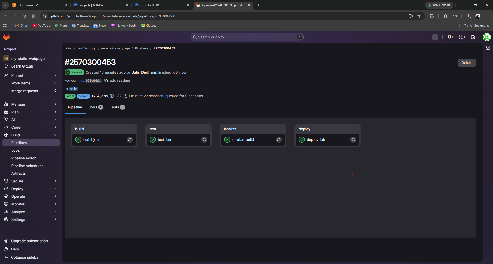
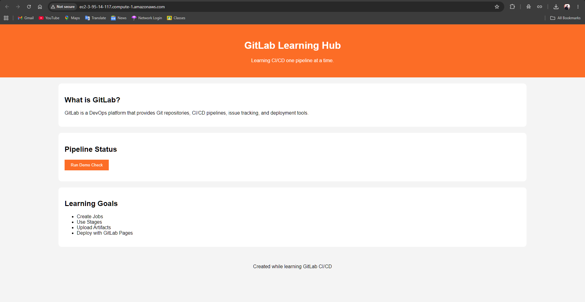
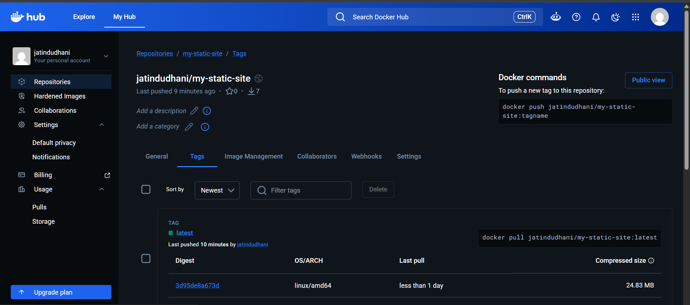

# DevOps Learning Project - GitLab CI/CD, Docker & AWS EC2

## Project Overview

This project was created as a hands-on learning journey to understand modern DevOps practices and deployment workflows.

The goal was not only to build a simple static website but also to automate its build, testing, packaging, and deployment using industry-standard tools.

Through this project I learned:

* Git & GitLab
* GitLab CI/CD Pipelines
* Linux & Shell Scripting
* Docker & Docker Hub
* AWS EC2
* Nginx
* SSH-based Deployments
* Artifact Management
* CI/CD Automation

---

# Project Architecture

```text
VS Code
   │
   ▼
Git Push
   │
   ▼
GitLab Repository
   │
   ▼
GitLab CI/CD Pipeline
   │
   ├── Build Stage
   ├── Test Stage
   ├── Docker Build Stage
   └── Deploy Stage
           │
           ▼
        AWS EC2
           │
           ▼
      Docker Container
           │
           ▼
        Nginx Server
           │
           ▼
      Static Website
```

---

# Technologies Used

| Category           | Technology   |
| ------------------ | ------------ |
| Version Control    | Git          |
| Source Repository  | GitLab       |
| CI/CD              | GitLab CI/CD |
| Scripting          | Shell Script |
| Containerization   | Docker       |
| Container Registry | Docker Hub   |
| Cloud Platform     | AWS EC2      |
| Web Server         | Nginx        |
| Operating System   | Ubuntu Linux |
| Editor             | VS Code      |

---

# Learning Journey

## Phase 1 - Static Website Deployment

Created a simple static website using:

* HTML
* CSS
* JavaScript

Initially deployed manually to an AWS EC2 instance running Nginx.

---

## Phase 2 - GitLab CI/CD

Created a GitLab pipeline with multiple stages:

### GitLab CI/CD Pipeline



### Build Stage

Responsibilities:

* Create build directory
* Copy website files
* Generate artifacts

### Test Stage

Responsibilities:

* Verify build output exists
* Validate required files

### Deploy Stage

Responsibilities:

* Connect to EC2 using SSH
* Upload website files
* Deploy automatically

### Website Running on AWS EC2



---

## Phase 3 - Shell Script Automation

Refactored pipeline logic into shell scripts.

### build.sh

Responsible for:

* Creating public directory
* Copying static files

### test.sh

Responsible for:

* Verifying build output

### deploy.sh

Responsible for:

* SSH authentication
* Deployment execution

Benefits:

* Cleaner pipeline
* Easier maintenance
* Reusable deployment logic

---

## Phase 4 - Docker

Containerized the application.

### Dockerfile

Built a Docker image using:

```dockerfile
FROM nginx:alpine
COPY public/ /usr/share/nginx/html/
EXPOSE 80
```

Learned:

* Docker Images
* Containers
* Docker Build Process
* Nginx Containers

### Docker Hub Repository



---

## Phase 5 - Docker Hub Integration

Configured GitLab CI/CD to:

1. Build Docker Image
2. Login to Docker Hub
3. Push Image Automatically

Learned:

* Docker Registries
* Access Tokens
* Automated Image Publishing

---

## Phase 6 - EC2 Container Deployment

Updated deployment workflow:

Old Approach:

```text
GitLab
   ↓
Copy Files
   ↓
EC2
```

New Approach:

```text
GitLab
   ↓
Docker Build
   ↓
Docker Hub
   ↓
EC2 Pull Image
   ↓
Run Container
```

Benefits:

* Consistent deployment
* Easier rollback
* Reproducible environments

---

# CI/CD Pipeline Flow

```text
Build
   ↓
Test
   ↓
Docker Build
   ↓
Push to Docker Hub
   ↓
Deploy to EC2
```

Every push automatically:

* Builds the project
* Runs tests
* Creates Docker image
* Pushes image to Docker Hub
* Deploys latest version to AWS EC2

---

# Key Concepts Learned

## Git

* Clone
* Commit
* Push
* Branching
* Merging

## GitLab

* Pipelines
* Jobs
* Stages
* Artifacts
* Variables

## Linux

* Permissions
* SSH
* SCP
* File System

## Shell Scripting

* Variables
* Automation
* Deployment Scripts

## Docker

* Dockerfile
* Images
* Containers
* Docker Hub

## AWS

* EC2
* Security Groups
* SSH Access

---

# Future Improvements

Planned next steps:

* Branch-based deployment pipelines
* Docker Compose
* Node.js Backend
* PostgreSQL Database
* Kubernetes
* Terraform
* Monitoring & Logging

---

# Project Status

Completed as a DevOps learning project.

Currently being extended into a full-stack application with Docker Compose, Node.js, PostgreSQL, and advanced CI/CD workflows.

---

# Author

Jatin Dudhani

B.Tech Student | Full Stack & DevOps Learner

Learning by building real-world projects and automating deployments using modern cloud-native tools.
